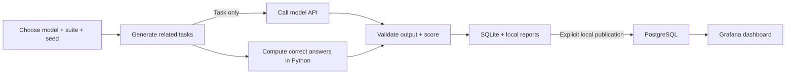

# Start here: what problem is RuleShift solving?

## The idea in one minute

Imagine a student answers a familiar question correctly. Have they learned the rule, or only that particular answer?

You would ask related questions: change a name, change a number, introduce an exception or add an unrelated detail. You would check whether the answer changes for the right reasons.

RuleShift does this for language models. One correct answer is useful evidence, but it does not show whether the model will apply the same rule reliably in your application.

**Our question:** can this model keep following the stated rules when details change?

**Our output:** a reproducible report showing successful cases, failing cases and the exact controlled differences behind them.

We do not claim to read a model's mind, prove philosophical understanding or determine conclusively whether a question appeared in training data.

## A concrete example

Suppose a shop's written policy says:

> Unused items returned within 30 days are eligible for a refund, including day 30.

Normal Python code can calculate the correct decisions:

| Test | Correct decision | Reason |
|---|---|---|
| Arun returns an unused item on day 20 | Allow | Both conditions are satisfied |
| Change Arun to Nila; everything else stays the same | Allow | Name is irrelevant |
| Mention that the customer owns three cats | Allow | Pet ownership is not a policy condition |
| Return on day 31 | Reject | Outside the window |
| Change the policy window to 14 days; return on day 20 | Reject | Apply the new rule |
| Add an explicit final-sale exclusion; item is final-sale | Reject | Apply the new exception |

An answer changing after only a name change is a counterexample worth investigating. A model ignoring a changed rule is a different failure. Both reveal more than one overall score, but neither alone establishes the hidden cause.

## Is this a benchmark tool?

Yes: **an evaluation and diagnostic tool with a small generated benchmark suite**. It does not train a model. It sends tasks to existing models and checks their answers.

There are three separate questions:

| Question | What we test | Meaning of a pass |
|---|---|---|
| Can I connect? | Endpoint and credentials | The probe obtained an API response |
| Can my application consume the output? | Strict numeric/boolean JSON | The probe followed this response format |
| Is it reliable on these tasks? | Accuracy, variations, repetitions and paired failures | Measured performance on the selected cases |

`check` sends one small probe. `run` evaluates a suite. A connection pass does not certify model quality, universal compatibility or suitability for every use case.

## Which models can I test?

Models must expose a supported text-generation API, and your account must have access to their exact model IDs.

| Interface | Adapter | Credential |
|---|---|---|
| Ollama on your computer | `ollama` | None for a standard local server |
| Claude direct API | `anthropic` | `ANTHROPIC_API_KEY` |
| OpenAI Responses, including available coding/Codex models | `responses` | `OPENAI_API_KEY` |
| Gemini direct API | `gemini` | `GEMINI_API_KEY` |
| Compatible local server or cloud gateway | `chat` and `--base-url` | Usually `RULESHIFT_API_KEY`, if needed |

“Any model” requires adapters, not just a brand name. A proprietary protocol needs another adapter. Browser-only chat apps, multimodal inputs, Bedrock signing, Azure-specific routing and tool-using agent workflows are not implemented here.

A **model** and an **agent application** are different. An API-accessible coding model can take this text test. Evaluating the full Codex or Claude Code application additionally needs a harness for tools, files and execution. This MVP does not provide that harness or reuse consumer-app login sessions.

Read [PROVIDERS.md](docs/PROVIDERS.md) for commands and API contracts.

## What happens inside?



The answer key never enters the model request. Grafana displays evidence; Python scoring and local records remain the source of truth. Grafana and PostgreSQL are self-hosted on your machine.

## First run: no keys needed

From the project folder:

```bash
python3 -m ruleshift demo --seeds 3 --repeats 2
python3 -m ruleshift list
```

The demo uses a reference parser and a deliberately brittle shortcut. They are **scripted controls, not actual LLMs**.

The command prints run IDs and report folders. Open `reports/<run-id>/README.md`, then inspect `cases.csv` or `report.json`.

There are currently three templates: notebook inventory, ticket totals and refunds. Each has six variants. Three seeds and two repeats produce **108 attempts per model**. A seed selects task parameters; a repeat asks the exact same task again.

## First real experiment

1. Choose a model you can already access.
2. For Ollama, ensure its server is running and `ollama list` shows an installed model. For a cloud provider, set its API key privately in your terminal.
3. Send a one-call probe:

   ```bash
   python3 -m ruleshift check --provider ollama --model YOUR_LOCAL_MODEL
   ```

4. Run a small suite:

   ```bash
   python3 -m ruleshift run --provider ollama --model YOUR_LOCAL_MODEL --seeds 3 --repeats 2
   ```

5. Read the local report and check coverage/errors before interpreting accuracy.
6. Follow [GRAFANA_SETUP.md](docs/GRAFANA_SETUP.md) to visualize the run locally.

Replace placeholders with real IDs. Hosted calls can be charged by the provider. Local evaluation and the self-hosted Grafana dashboard need no observability subscription. Your machine supplies their compute/storage; cloud hosting would have its own cost.

## Reading results

- **E2E accuracy:** correct answers divided by all attempts; transport/format errors count as failed attempts.
- **Valid response coverage:** proportion of calls producing the required answer format.
- **Valid-only accuracy:** accuracy after separating transport/format failures; read it together with coverage.
- **Paired regression:** correct baseline, wrong related variant.
- **Invariant violation:** answer changed after only a name or explicitly irrelevant detail changed.
- **Baseline repeat variability:** identical inputs already produced different answers.
- **95% cluster interval:** uncertainty conditional on the selected suite, keeping repeated attempts grouped. It is not confidence in “understanding.”

100% on these templates means the model passed these tasks. A failure could be arithmetic, wording, output format or a service problem. Neither outcome proves a model's general capabilities or internal mechanism.

## Comparing models

Use identical template versions, suite, seeds, repeats and requested settings:

```bash
python3 -m ruleshift compare RUN_A RUN_B --output reports/comparison.json
```

The command rejects mismatches and reports descriptive differences by variation. Even matching requests do not make hidden reasoning, token accounting, vendor defaults or hardware identical.

## Is it unique enough for Kiroween?

**A general “evaluate any LLM” tool is not new.** [Promptfoo](https://www.promptfoo.dev/docs/configuration/expected-outputs/) and [DeepEval](https://deepeval.com/docs/metrics-introduction) already offer evaluation capabilities. Adding a dashboard alone does not establish novelty or guarantee a win.

The strongest product angle is specific:

> Show developers the small controlled change that breaks their AI's rule-following, with a code-verified counterexample they can reproduce.

This combines paired changes, ordinary-code answer keys, separate error categories and observability. It is a useful foundation; three simple templates are still too narrow for a broad or unique benchmark claim.

| Implemented now | Strong next contribution |
|---|---|
| Seeded variations and exact answer checks | Larger human-reviewed policy suite with realistic exceptions |
| Paired baseline/variant failures | A focused view explaining which condition changed and why the answer should change |
| Multiple API adapters | Actual model-version comparisons under a locked protocol |
| Local comparison and Grafana integration | A measured improvement tested on private structural holdouts |

Develop those next features genuinely in Kiro, retain its actual artifacts and record what it contributed. This starter was prepared with Codex; it does not establish Kiro usage. Review the current [Kiroween rules](https://kiroween.devpost.com/rules) before selecting a category or submitting.

## Your next three actions

1. Run the offline demo and explain one controlled failure in your own words.
2. Connect a real model, inspect it, then compare a second model under matching settings.
3. Build a larger reviewed policy suite in Kiro and demonstrate a reproducible improvement on untouched cases.

Further reading: [paper review](docs/PAPER_REVIEW.md), [provider guide](docs/PROVIDERS.md), [Grafana setup](docs/GRAFANA_SETUP.md), [hackathon work plan](docs/NEXT_STEPS.md).
